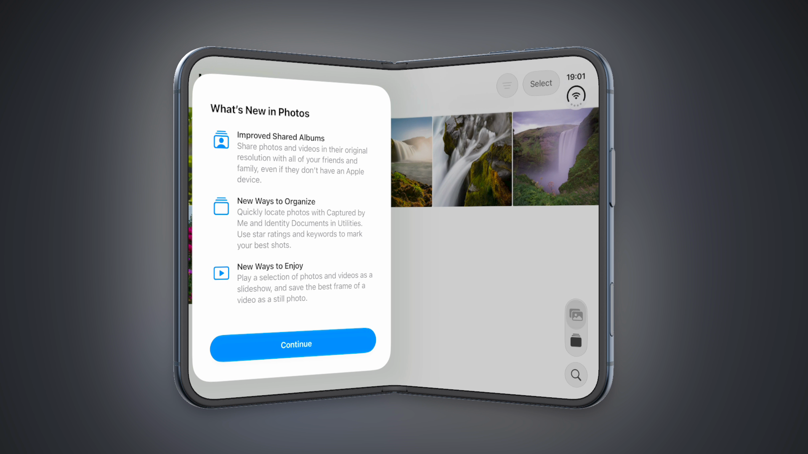
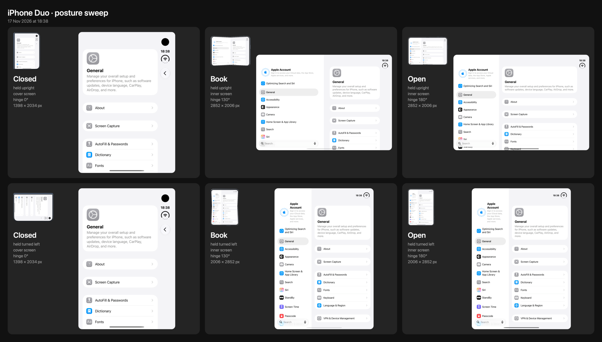

<h1 align="center">duorex</h1>

<h3 align="center">A real iPhone Duo in your terminal pane.</h3>

<p align="center">
  
</p>

duorex puts a 3D iPhone Duo in a [Rex](https://www.superlogical.com/rex) pane. The device is Apple's own model from Xcode, and its screens are the live simulator. You fold it with your pointer, and your agent can use the same device while you watch.

## Fold it like the real thing

Drag the frame and the device folds under your pointer. The simulator's hinge follows, so your app lays out again as the angle changes. Let go and it stays at that angle. Close to shut or to flat, it finishes the move.

`1`, `2` and `3` go to closed, book and open. `[` and `]` move the hinge 10 degrees.

The device makes a sound when it shuts and when it opens flat, louder for a fast fold. `m` turns the sound off.

## Touch what you see

Click, drag and scroll on either screen. The touch lands where you point, on a flat screen and on a bent one. `r` turns the device a quarter turn, and `h` swipes home.

Hold Option and drag on a screen to pinch. The pointer is one finger, and the other mirrors it about the middle of the screen. Both show as pale spots, also before you press.

Drag the background to turn the device. A long drag turns it all the way round, so you see its back. It comes back to the front when you let go.

## Press its buttons

The power, volume and camera control buttons on the frame are real. Click one and it goes into the frame, and the simulator gets the press: the volume changes, the screen locks. Hold it and the simulator sees it held.

The buttons are small, so rest the pointer on one and the pane names it. On a closed device the front half covers them, and they still work where the pane names them.

## Test the settings with one key

`d` switches between the light and the dark appearance. `+` and `-` change the text size. `s` makes every animation slow, and `w` sends a memory warning. The line under the device says what changed.

## See every posture at once

`duorex sweep` folds the simulator through closed, book and open, held upright and turned, and saves one picture of them all. Each cell shows the screen the right way up, the device in that posture, and the size your app got.

```sh
duorex sweep --out sweep.png
```

<p align="center">
  
</p>

It takes about 20 seconds and puts the simulator back the way it was. Run it from any shell: it needs no pane. With a duorex pane open, you watch the sweep happen in it.

## Record a clean clip

`duorex record` shows the device as usual and records everything you do with it, until you press `q`. The movie shows the device alone on a dark stage, lit by its own screens, at 1920 by 1080 and up to 60 frames a second. The picture at the top of this page is a frame from one.

```sh
duorex record                                   # saves to ~/Movies/duorex-<time>.mp4
duorex record --out demo.mp4 --size 1080x1080
```

## It stays in its pane

duorex runs in the pane as a terminal program and draws the device in a window over it. Rex keeps the pointer and the keyboard, so the pane focuses, splits and closes like any other.

Move the Rex window or change the layout and the device follows. Switch to another tab and it hides.

## Your agent uses the same device

duorex runs the simulator through [serve-sim](https://github.com/EvanBacon/serve-sim), so an agent in the next pane can drive it from the shell while you watch:

```sh
npx serve-sim tap 0.5 0.4    # a point on the screen, from 0 to 1
npx serve-sim fold 130
```

When the agent folds the device, the one in your pane folds too. When it touches the screen, you see where: a tap leaves a spot with a ring, and a swipe leaves a trail. The line under the device says what the agent does, such as `agent · swipe ↑`. Your own touches leave no mark.

The marks are part of the device, so `duorex record` puts them in the movie too.

The agent can also run `duorex sweep` and read the sheet, to check its own work in every posture.

## Install

```sh
curl -fsSL https://raw.githubusercontent.com/tornikegomareli/duorex/main/install.sh | sh
```

The installer builds duorex from source and puts it in `~/.local/bin`.

Requirements:

- A Mac with Apple silicon, on macOS 15 or newer
- Xcode 27.1 or newer, with an iOS 27.1 or newer simulator runtime
- Node.js, for serve-sim
- Rex, or another terminal that reports the pointer in pixels, such as Ghostty

To open the device with a key in Rex, load the action from `~/.config/rex/init.lua`. The installer puts it in `~/.config/rex/duorex.lua`:

```lua
require("duorex")
rex.bind("ctrl+p>i", "duorex")
```

To update:

```sh
duorex update
```

## Remove

```sh
rm -f ~/.local/bin/duorex ~/.config/rex/duorex.lua
rm -rf ~/.local/share/duorex
defaults delete duorex 2>/dev/null   # the saved pane position
```

Delete the two lines from `~/.config/rex/init.lua` if you added them. serve-sim keeps running after duorex quits. To stop it and delete the simulator:

```sh
npx serve-sim --kill
xcrun simctl delete "duorex Duo"
```

## Using it

Run `duorex` in a pane. The first run creates a simulator named "duorex Duo" and starts serve-sim for it, which takes about 30 seconds. Later runs attach to the running server.

- Click or drag on a screen to touch it. Scroll to scroll.
- Drag the frame to fold. Option-drag off the screen folds from anywhere.
- Option-drag on a screen pinches.
- Click a button on the frame to press it.
- Drag the background to turn the device. It comes back when you let go.
- `1` `2` `3` choose closed, book and open. `[` and `]` fold 10 degrees less or more.
- `r` rotates, `h` goes home, `q` quits.
- `d` switches dark mode. `+` and `-` change the text size. `s` slows the animations. `w` sends a memory warning.
- `m` turns the fold sounds off or on.
- `?` shows the keys, a few at a time.

The first time duorex runs in a terminal, move the pointer over the pane once. That tells duorex where the pane is on screen.

Options:

- `--device <name|udid>` uses another iPhone Duo simulator.
- `--server <url>` attaches to a serve-sim that is already running, such as `http://127.0.0.1:3100`.
- `--finish Light` shows the light model. The default is `Dark`.

## Limits

- The camera control press goes to the simulator, but iOS showed no reaction to it in our tests.
- duorex shows the touches that reach the simulator through serve-sim. A tool that touches it another way leaves no mark.
- serve-sim reports a swipe when the finger first moves and when it comes up, so the trail is drawn after the swipe.
- serve-sim follows one touch at a time. When you and an agent touch at the same moment, the agent's mark can be cut short.
- Typing does not reach the simulator. With Xcode 27, serve-sim can type only through Device Hub.
- Folding and touches on the inner screen use private Xcode interfaces through serve-sim, so an Xcode update can break them. duorex pins the serve-sim release it was written against.
- Outside Rex, the device does not hide when you switch tabs, because other terminals do not report their layout.

## Development

```sh
swift build
swift test
.build/debug/duorex snapshot --pattern --hinge 130 --out duo.png   # one frame, no window
.build/debug/duorex snapshot --pattern --touch 0.3,0.4 --out tap.png   # the same, with a touch mark
```

The device is `DuoScene`, drawn into `Frame`s by `StageView`. `DeviceMotion` holds its pose and turns the pointer into touches, tilts and folds. `Sim` and `ScreenFeed` bring the simulator's screen to it, in the wire format `SimWire` knows, and `PoseSync` decides whether the device or the simulator moved first. `Presence` turns the touches of other clients into marks, and `MarkLayer` draws them on the screen. `Pane` reads the terminal through `TerminalInput`, and `Dock` keeps the window where `PaneLocator` says the pane is.

## License

[MIT License](LICENSE).
